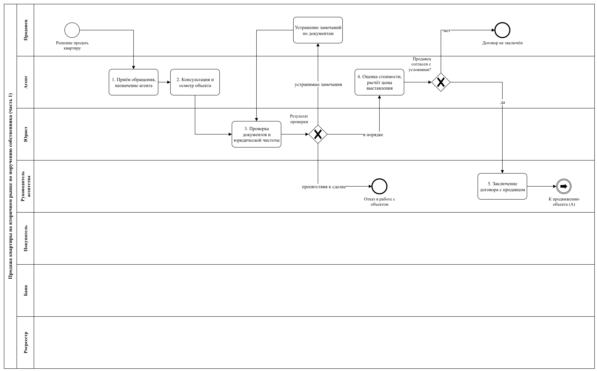
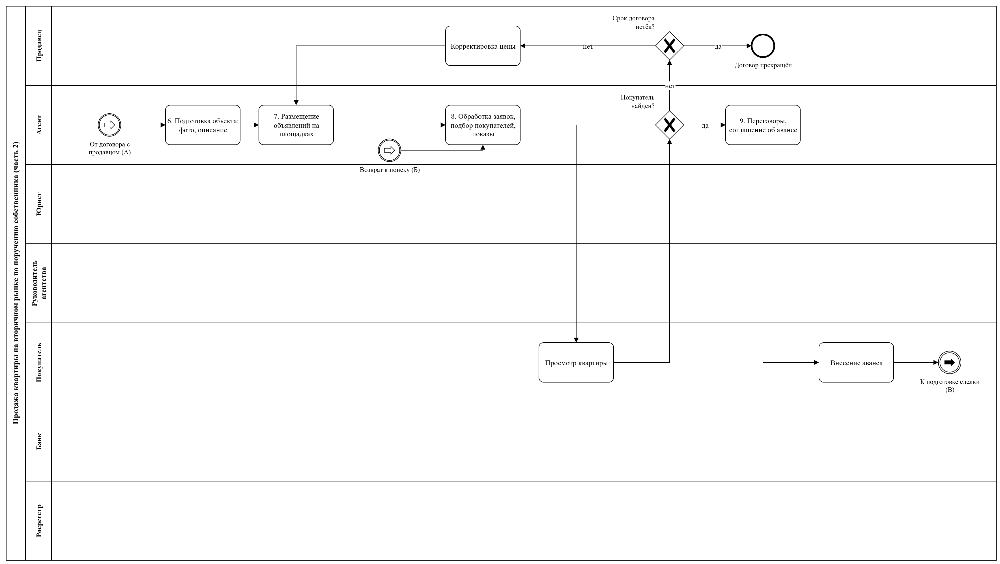
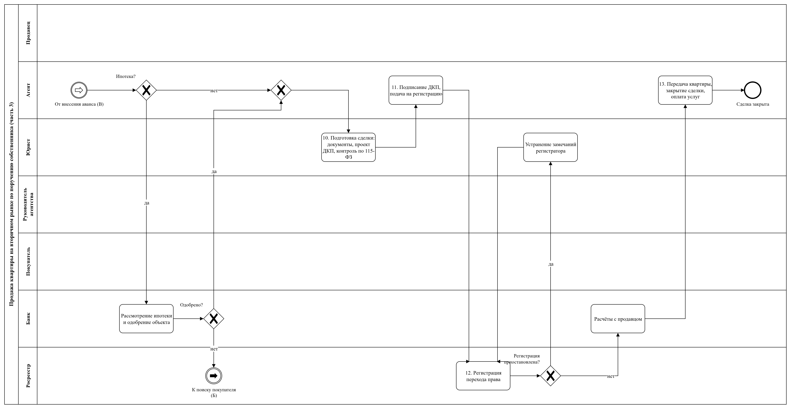

# 1. Модель основного бизнес-процесса в нотации BPMN 2.0

> Черновик. Диаграмма: `diagrams/bpmn-prodazha-kvartiry.drawio` (3 страницы), генерируется `tools/diagrams/gen.py`. PNG для отчёта: `diagrams/png/` (экспорт из draw.io).

## 1.1. Выбор нотации

Для моделирования процесса продажи квартиры выбрана нотация BPMN 2.0 (Business Process Model and Notation — модель и нотация бизнес-процессов), закреплённая международным стандартом ISO/IEC 19510:2013. Нотация позволяет показать на одной диаграмме последовательность операций, их исполнителей, точки ветвления и альтернативные исходы процесса, поэтому подходит для выявления операций, которые следует автоматизировать.

Модель построена по текстовому описанию процесса из исследовательского этапа, элементы нотации приведены в Таблице 1.1.

| Элемент | Обозначение | Назначение в модели |
|---|---|---|
| Пул | прямоугольник с вертикальным заголовком | процесс продажи квартиры в целом |
| Дорожка | полоса внутри пула | участник процесса: продавец, агент, юрист, руководитель агентства, покупатель, банк, Росреестр |
| Задача | прямоугольник со скруглёнными углами | отдельная операция процесса |
| Стартовое событие | тонкий круг | начало процесса: решение собственника продать квартиру |
| Конечное событие | толстый круг | исход процесса: сделка закрыта, договор не заключён, договор прекращён и др. |
| Исключающий шлюз | ромб с косым крестом | ветвление по условию и слияние ветвей |
| Промежуточное событие-ссылка | двойной круг со стрелкой | переход между частями диаграммы (метки А, Б, В) |
| Поток управления | сплошная стрелка | порядок выполнения операций |

Внешние участники (продавец, покупатель, банк, Росреестр) показаны дорожками общего пула, а не отдельными пулами, чтобы сохранить сквозную последовательность операций. Модель из более чем тридцати элементов разделена на три части, соединённые событиями-ссылками.

## 1.2. Часть 1. Заключение договора с продавцом

Первая часть модели показана на Рисунке 1.1. Процесс начинается с решения собственника продать квартиру. Агентство принимает обращение и назначает агента, который проводит консультацию и осматривает объект. Затем юрист проверяет документы и юридическую чистоту объекта. По результату проверки возможны три исхода: документы в порядке; выявлены устранимые замечания, и продавец их устраняет, после чего проверка повторяется; выявлены препятствия к сделке, и агентство отказывается от работы с объектом.

Если документы в порядке, агент оценивает стоимость квартиры и предлагает продавцу цену выставления и условия договора. При несогласии продавца процесс завершается без договора, при согласии руководитель агентства заключает договор, и процесс переходит ко второй части (ссылка А).

{landscape}

## 1.3. Часть 2. Поиск покупателя

Вторая часть модели показана на Рисунке 1.2. Агент готовит объект к продаже, размещает объявления на онлайн-площадках, обрабатывает заявки покупателей и организует показы. Если покупатель не найден, проверяется срок договора: по его истечении договор прекращается, в противном случае продавец и агент корректируют цену и объявления обновляются. Когда покупатель найден, стороны согласуют условия, покупатель вносит аванс, и процесс переходит к третьей части (ссылка В). В задачу поиска покупателей процесс возвращается также из третьей части, если банк отказал покупателю в ипотеке (ссылка Б).

{landscape}

## 1.4. Часть 3. Сделка и регистрация перехода права

Третья часть модели показана на Рисунке 1.3. Если покупатель использует ипотеку, банк рассматривает заявку и одобряет объект; при отказе процесс возвращается к поиску покупателя. Затем юрист и агент готовят сделку: собирают пакет документов, готовят проект договора купли-продажи (ДКП) и проверяют, подлежит ли сделка обязательному контролю по Федеральному закону от 07.08.2001 № 115-ФЗ. После подписания ДКП документы подаются в Росреестр. Если регистрация приостановлена, юрист устраняет замечания регистратора, после чего регистрация продолжается. После регистрации перехода права проводятся расчёты с продавцом, квартира передаётся покупателю, агентство получает оплату своих услуг и закрывает сделку.

{landscape}

## 1.5. Выводы

Модель содержит 7 участников, 20 задач, 8 шлюзов и 4 возможных исхода процесса: сделка закрыта, договор не заключён, договор прекращён, отказ в работе с объектом. Основную часть операций выполняет агент. Именно его задачи (оценка стоимости, работа с объявлениями и заявками, подготовка сделки и контроль сроков) связаны с обработкой наибольшего объёма информации и рассматриваются далее как кандидаты на автоматизацию.
