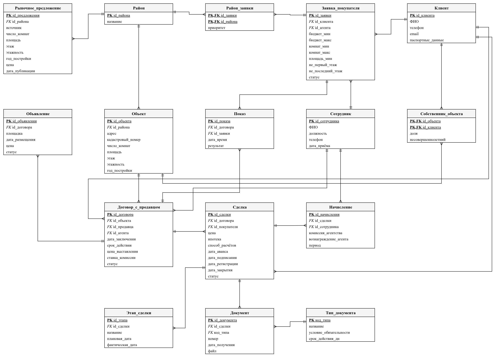

# 3. Логическая модель данных предметной области

> Черновик. Диаграмма: `diagrams/er-logicheskaya-model.drawio`, генерируется `tools/diagrams/gen.py`.

## 3.1. Подход к построению модели

Логическая модель данных построена в виде диаграммы «сущность — связь» (ER-диаграммы, от англ. Entity-Relationship) в нотации «вороньи лапки» (Crow's Foot). Сущности выделены по объектам модели процесса и автоматизируемых операций. Модель не зависит от конкретной системы управления базами данных (СУБД); типы данных, индексы и ограничения будут заданы при построении физической модели на этапе 5.

Диаграмма приведена на Рисунке 3.1. Первичные ключи (PK) выделены полужирным шрифтом и подчёркиванием, внешние ключи (FK) — курсивом.

{landscape}

## 3.2. Сущности

Состав сущностей и их атрибуты приведены в Таблице 3.1.

| Сущность | Назначение | Основные атрибуты |
|---|---|---|
| Клиент | физическое лицо — продавец, собственник или покупатель | ФИО, телефон, email, паспортные данные |
| Сотрудник | работник агентства: агент, юрист, руководитель | ФИО, должность, телефон, дата приёма |
| Район | справочник районов города | название |
| Объект | квартира, которую продаёт агентство | район, адрес, кадастровый номер, число комнат, площадь, этаж, этажность, год постройки |
| Собственник_объекта | доля клиента в праве собственности на объект | доля, признак несовершеннолетнего собственника |
| Договор_с_продавцом | договор возмездного оказания услуг с продавцом | объект, продавец, агент, дата, срок действия, цена выставления, ставка комиссии, статус |
| Объявление | публикация объекта на онлайн-площадке | договор, площадка, дата размещения, цена, статус |
| Заявка_покупателя | требования покупателя к квартире | клиент, агент, бюджет, диапазон числа комнат, минимальная площадь, ограничения по этажу, статус |
| Район_заявки | район, подходящий покупателю | заявка, район, приоритет |
| Показ | показ объекта по заявке | договор, заявка, дата и время, результат |
| Сделка | продажа объекта конкретному покупателю | договор, покупатель, цена, признак ипотеки, способ расчётов, даты аванса, подписания, регистрации и закрытия, статус |
| Этап_сделки | контрольная точка сделки | сделка, название, плановая и фактическая даты |
| Тип_документа | справочник документов, необходимых для сделки | название, условие обязательности, срок действия в днях |
| Документ | документ, полученный по сделке | сделка, тип, номер, дата получения, файл |
| Начисление | комиссия агентства и вознаграждение агента по сделке | сделка, сотрудник, комиссия агентства, вознаграждение агента, период |
| Рыночное_предложение | объявление о продаже квартиры, собранное с онлайн-площадок для оценки | район, источник, число комнат, площадь, этаж, этажность, год постройки, цена, дата публикации |

Сущность «Рыночное_предложение» не связана с остальными сущностями, кроме справочника районов. Она хранит внешние данные о рынке, по которым алгоритм 1 подбирает объекты-аналоги.

## 3.3. Связи

Все связи между сущностями имеют тип «один ко многим» и показаны на Рисунке 3.1. Связь «многие ко многим» между клиентами и объектами (у квартиры может быть несколько собственников, клиент может владеть несколькими квартирами) разрешена ассоциативной сущностью «Собственник_объекта», связь между заявками и районами — сущностью «Район_заявки».

Связь «Договор_с_продавцом — Сделка» имеет кратность «один ко многим», потому что сделка с первым покупателем может сорваться (например, при отказе банка в ипотеке), и по тому же договору оформляется новая сделка.

## 3.4. Нормализация

Модель приведена к третьей нормальной форме (3НФ):

- все атрибуты атомарны: многозначные требования заявки (несколько районов) вынесены в отдельную сущность, а диапазон числа комнат задан двумя атрибутами;
- каждый неключевой атрибут зависит от всего первичного ключа, в том числе в сущностях с составным ключом «Собственник_объекта» и «Район_заявки»;
- транзитивных зависимостей нет: характеристики квартиры хранятся только в сущности «Объект», название района — только в справочнике «Район», а сведения о сроке действия документа — в справочнике «Тип_документа».

Расчётные значения (рекомендуемая цена, оценка соответствия объекта заявке, готовность сделки) в модели не хранятся: их вычисляют алгоритмы по исходным данным. Исключение — сущность «Начисление»: суммы комиссии фиксируются, потому что они служат основанием для выплат и не должны меняться при последующем изменении шкалы вознаграждения.
