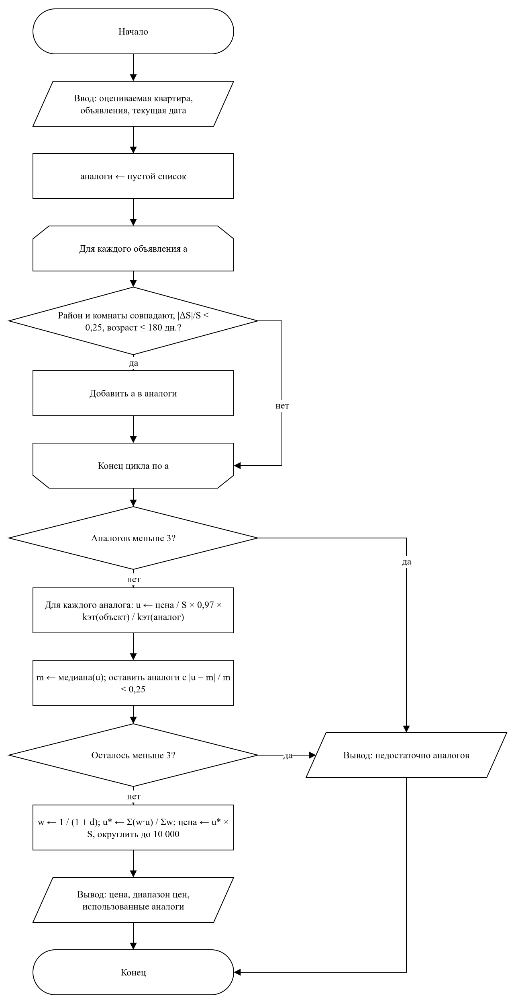
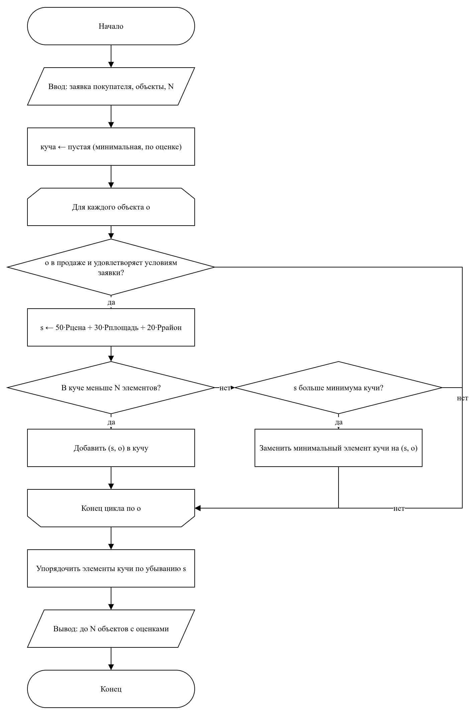
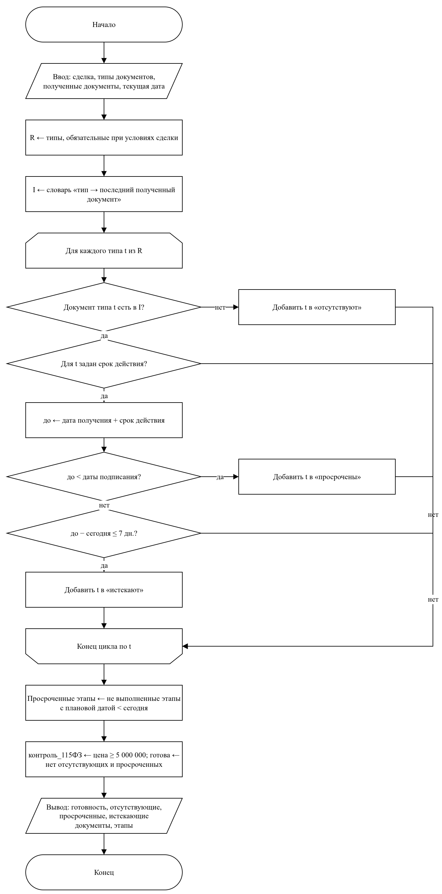
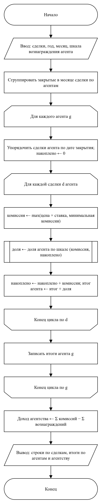
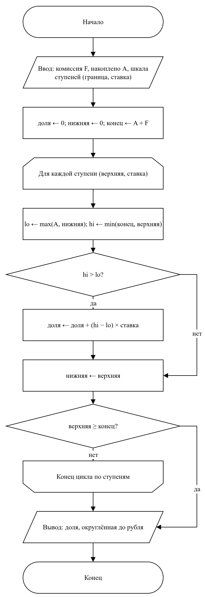

# 4. Алгоритмы решения задачи

> Черновик. Схемы: `diagrams/algoritmy.drawio` (5 страниц), генерируются `tools/diagrams/gen.py`. Замеры: `src/python/bench.py`.

## 4.1. Общие положения

Для операций, выбранных в разделе 2, разработаны четыре алгоритма и одна вспомогательная подпрограмма. Схемы алгоритмов выполнены по ГОСТ 19.701-90 «Схемы алгоритмов, программ, данных и систем. Обозначения условные и правила выполнения». Входные и выходные данные алгоритмов приведены в Таблице 4.1.

| Алгоритм | Входные данные | Выходные данные |
|---|---|---|
| 1. Оценка стоимости квартиры | характеристики оцениваемой квартиры; рыночные предложения; текущая дата | рекомендуемая цена, диапазон цен, цена 1 м², список использованных аналогов либо признак недостаточности аналогов |
| 2. Подбор объектов под заявку | заявка покупателя; объекты агентства; число N результатов | до N объектов, упорядоченных по оценке соответствия от 0 до 100 |
| 3. Контроль документов и сроков | сделка (условия, дата подписания, этапы); справочник типов документов; полученные документы; текущая дата | признак готовности к подписанию; списки отсутствующих, просроченных и истекающих документов; просроченные этапы; признак обязательного контроля по 115-ФЗ |
| 4. Расчёт комиссии за месяц | сделки; год и месяц; шкала вознаграждения агента | комиссия и вознаграждение по каждой сделке; итоги по агентам; доход агентства |

Числовые параметры алгоритмов (допуски, коэффициенты, веса, минимальная комиссия, ступени шкалы) условны: в системе их задаёт агентство, в программе они вынесены в именованные константы, например `AREA_TOLERANCE = 0.25`.

## 4.2. Алгоритм 1. Оценка стоимости квартиры

Алгоритм реализует сравнительный подход к оценке: стоимость квартиры определяется по ценам предложений аналогичных квартир. Схема алгоритма приведена на Рисунке 4.1.

1. Отбор аналогов. Из рыночных предложений выбираются квартиры в том же районе, с тем же числом комнат, площадью, отличающейся от площади оцениваемой квартиры не более чем на 25 %, и объявлениями не старше 180 дней.
2. Если аналогов меньше трёх, оценка не выполняется.
3. Корректировка. Для каждого аналога рассчитывается цена 1 м² за вычетом скидки на торг (3 %) и с поправкой на категорию этажа: u = P / S × 0,97 × kэт(объект) / kэт(аналог), где kэт = 0,95 для первого этажа, 0,97 для последнего и 1 для остальных.
4. Исключение выбросов. Находится медиана m удельных цен, исключаются аналоги, у которых |u − m| / m > 0,25. Если осталось меньше трёх аналогов, оценка не выполняется.
5. Расчёт. Каждому аналогу присваивается вес w = 1 / (1 + d), где d — сумма относительного различия площадей и разницы годов постройки, делённой на 50. Удельная цена объекта равна средневзвешенной u* = Σ(w·u) / Σw, рекомендуемая цена — u* × S с округлением до 10 000 руб., диапазон — от минимальной до максимальной скорректированной удельной цены, умноженной на площадь.

Пусть n — число рыночных предложений, k — число отобранных аналогов (k ≤ n). Отбор требует одного прохода по предложениям — O(n). Корректировка, исключение выбросов и расчёт выполняются за O(k), а поиск медианы с сортировкой — за O(k log k). Итоговая сложность — O(n + k log k), в худшем случае, когда все предложения оказываются аналогами, — O(n log n). На практике k много меньше n, так как аналоги составляют малую долю рынка, и время работы растёт линейно. Дополнительная память — O(k).

## 4.3. Алгоритм 2. Подбор объектов под заявку покупателя

Схема алгоритма приведена на Рисунке 4.2.

1. Для каждого объекта проверяются жёсткие условия заявки: объект в продаже, цена не превышает бюджет более чем на 5 % (резерв на торг) и не ниже минимального бюджета, число комнат и район входят в допустимые, площадь не меньше минимальной, этаж удовлетворяет ограничениям «не первый» и «не последний».
2. Для объекта, прошедшего проверку, вычисляется оценка соответствия s = 50·Pцена + 30·Pплощадь + 20·Pрайон, где каждый показатель принимает значения от 0 до 1. Pцена = 1, если цена в пределах бюджета, и линейно уменьшается при превышении бюджета. Pплощадь растёт с запасом площади над минимальной и достигает 1 при запасе 30 %. Pрайон = 1 для района с наивысшим приоритетом и уменьшается для районов с меньшим приоритетом.
3. Пары (оценка, объект) накапливаются в минимальной куче размера N: пока куча не заполнена, элемент добавляется; затем новый элемент заменяет минимальный, только если его оценка больше.
4. Элементы кучи упорядочиваются по убыванию оценки.

Пусть n — число объектов. Проверка условий и вычисление оценки выполняются за O(1) для каждого объекта, операции с кучей — за O(log N). Итоговая сложность — O(n log N) плюс O(N log N) на финальное упорядочивание. Поскольку N — небольшая константа (как правило, 5–20 объектов на экране), сложность практически линейна: O(n). Альтернативное решение — полная сортировка подходящих объектов — потребовало бы O(n log n) времени и O(n) памяти, тогда как куча требует O(N) памяти.

## 4.4. Алгоритм 3. Контроль документов и сроков сделки

Схема алгоритма приведена на Рисунке 4.3.

1. Формируется перечень R обязательных типов документов. Тип включается в перечень, если он обязателен всегда или если выполнено его условие обязательности: ипотека, наличие несовершеннолетних собственников, брак продавца.
2. Полученные документы индексируются словарём I «тип → последний полученный документ этого типа».
3. Для каждого типа t из R: если документа нет в I, тип добавляется в список отсутствующих; если для типа задан срок действия и документ перестаёт действовать до даты подписания, тип добавляется в список просроченных; если до окончания срока действия осталось не более 7 дней, тип добавляется в список истекающих.
4. Определяются просроченные этапы сделки: не выполненные этапы с плановой датой раньше текущей.
5. Определяется признак обязательного контроля: цена сделки 5 млн руб. и более (п. 1.1 ст. 6 Федерального закона от 07.08.2001 № 115-ФЗ).
6. Сделка готова к подписанию, если нет отсутствующих и просроченных документов.

Пусть t — число типов документов в справочнике, d — число полученных документов, s — число этапов сделки. Формирование перечня требует O(t), построение словаря — O(d) (вставка и поиск в хеш-таблице выполняются в среднем за O(1)), проверка перечня — O(t), проверка этапов — O(s). Итоговая сложность — O(t + d + s), память — O(t + d). Без предварительной индексации поиск документа каждого типа перебором всех документов потребовал бы O(t·d) времени.

## 4.5. Алгоритм 4. Расчёт комиссии агентства и вознаграждения агентов

Комиссия агентства по сделке равна произведению цены на ставку договора, но не меньше минимальной комиссии. Вознаграждение агента рассчитывается по прогрессивной шкале от суммы комиссии, накопленной агентом за месяц: каждая часть комиссии оплачивается по ставке своей ступени. В программе использована шкала из трёх ступеней: до 300 тыс. руб. — 40 %, от 300 до 600 тыс. руб. — 50 %, свыше 600 тыс. руб. — 60 %. Такой способ расчёта не зависит от того, как сделки распределены внутри месяца: сумма вознаграждений по отдельным сделкам совпадает с вознаграждением, рассчитанным от общей суммы комиссии.

Схема алгоритма приведена на Рисунке 4.4, схема подпрограммы расчёта доли агента по шкале — на Рисунке 4.5.

1. Закрытые в заданном месяце сделки группируются по агентам.
2. Сделки каждого агента упорядочиваются по дате закрытия, накопленная комиссия обнуляется.
3. Для каждой сделки рассчитывается комиссия агентства, по подпрограмме — доля агента с учётом накопленной комиссии, затем накопленная комиссия увеличивается.
4. Рассчитываются итоги по агентам и доход агентства как разность суммы комиссий и суммы вознаграждений.

Пусть m — общее число сделок, m′ — число сделок, закрытых в месяце, T — число ступеней шкалы. Отбор и группировка требуют O(m), сортировка сделок агентов — не более O(m′ log m′), расчёт по шкале — O(T) на сделку. Итоговая сложность — O(m + m′ log m′ + m′·T). Число ступеней постоянно, поэтому сложность составляет O(m + m′ log m′), память — O(m′).

## 4.6. Сводная оценка и экспериментальная проверка

Оценки вычислительной сложности сведены в Таблицу 4.2.

| Алгоритм | Время | Память | Определяющая операция |
|---|---|---|---|
| 1. Оценка стоимости | O(n + k log k), в худшем случае O(n log n) | O(k) | отбор аналогов, поиск медианы |
| 2. Подбор объектов | O(n log N) ≈ O(n) | O(N) | проверка условий, операции с кучей |
| 3. Контроль документов | O(t + d + s) | O(t + d) | построение словаря документов |
| 4. Расчёт комиссии | O(m + m′ log m′) | O(m′) | сортировка сделок агентов |

Для проверки оценок время работы программной реализации (раздел 5) измерено на синтетических данных объёмом от 1 000 до 1 000 000 записей. Для алгоритма 3 число документов равно n, а число типов документов — n / 100; для алгоритма 4 все сделки закрыты в одном месяце (m′ = m). Измерения выполнены на процессоре Intel Core i7-13700H под управлением интерпретатора Python 3.14, в таблице приведена медиана пяти запусков (Таблица 4.3).

| Объём данных n | Алгоритм 1, мс | Алгоритм 2, мс | Алгоритм 3, мс | Алгоритм 4, мс |
|---|---|---|---|---|
| 1 000 | 0,3 | 0,4 | 0,7 | 2,4 |
| 10 000 | 2,2 | 4,3 | 6,7 | 24,9 |
| 100 000 | 28,2 | 44,2 | 69,1 | 395,6 |
| 1 000 000 | 280,6 | 434,4 | 843,6 | 5 561,0 |

Время работы алгоритмов 1–3 при увеличении объёма данных в 10 раз возрастает примерно в 10 раз, что подтверждает их линейную сложность на практических данных. Время алгоритма 4 растёт быстрее линейного (в 14–16 раз при переходе к 100 000 и 1 000 000 записей), что согласуется с оценкой O(m log m) за счёт сортировки. Для агентства с месячным оборотом в сотни сделок и базой в десятки тысяч объявлений время работы всех алгоритмов не превышает десятков миллисекунд.
