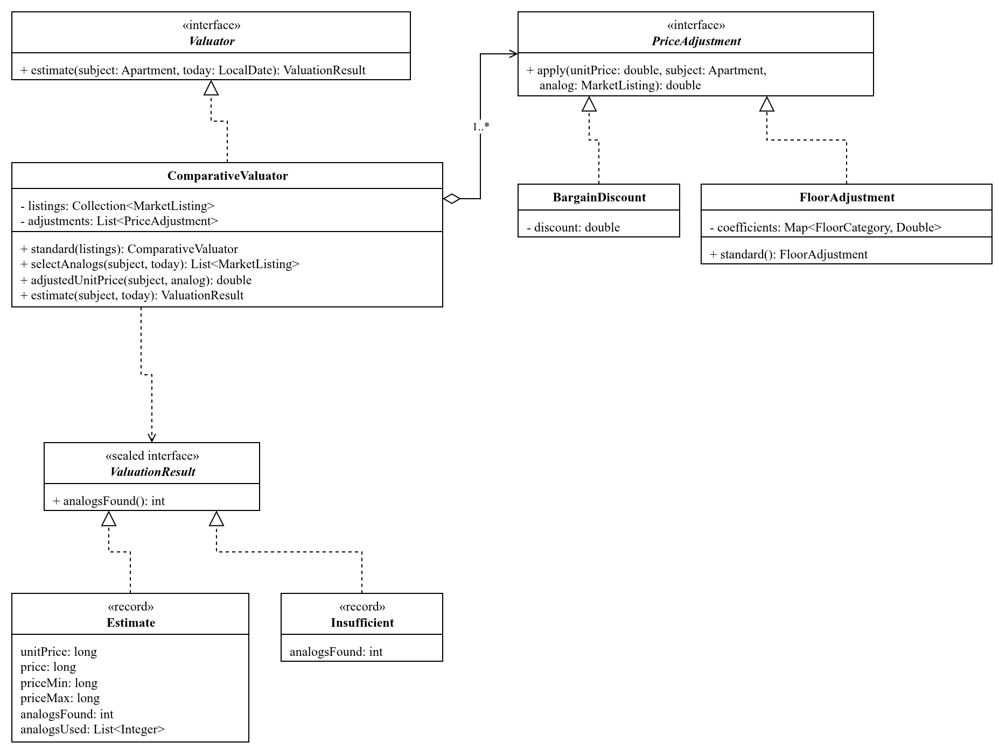
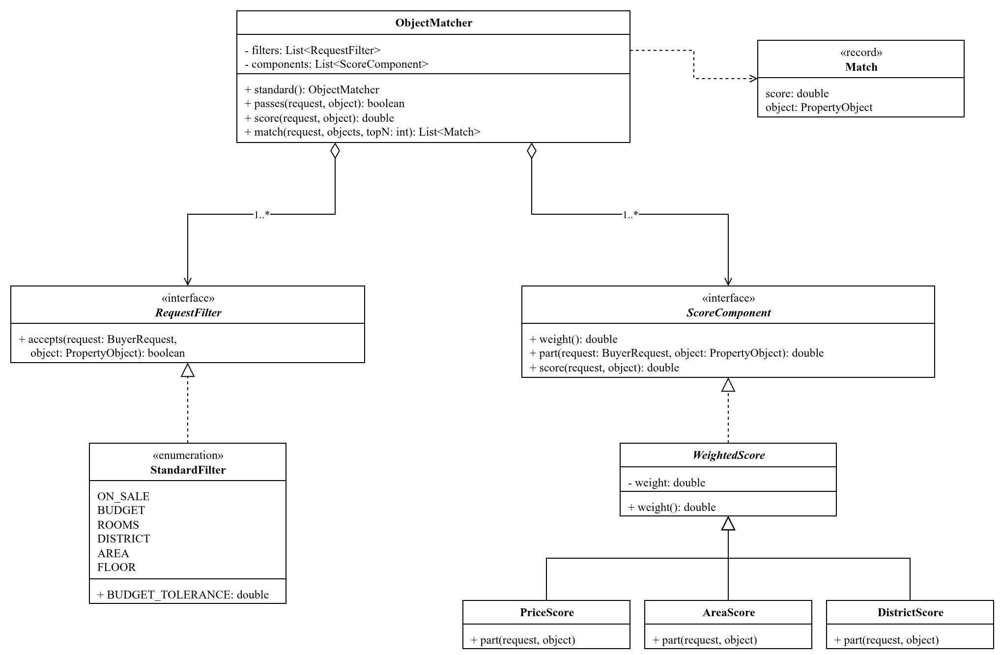

# 1. Проектирование классов, иерархий наследования и интерфейсов

> Черновик. Диаграммы: `diagrams/uml-klassy.drawio` (4 страницы), генерируются `tools/diagrams/gen.py uml`, PNG — `tools/diagrams/export.sh`. Код: `src/java/`.

## 1.1. Принципы проектирования

Объектно-ориентированная реализация решает те же четыре задачи, что и процедурная реализация аналитического этапа: оценку стоимости квартиры, подбор объектов под заявку покупателя, контроль документов и сроков сделки и расчёт комиссии. В процедурной реализации данные представлены словарями, а обработка — функциями без состояния. При переходе к объектно-ориентированному проектированию приняты следующие решения:

- данные и операции над ними объединены в классы предметной области, построенные по сущностям логической модели данных; конструктор проверяет допустимость значений, поэтому объект с некорректным состоянием создать нельзя;
- изменяемые части алгоритмов вынесены в интерфейсы: корректировки цены, условия заявки, составляющие оценки соответствия, проверки сделки, правило расчёта комиссии и шкала вознаграждения; класс алгоритма зависит от интерфейса, а не от конкретной реализации;
- новое правило добавляется новым классом, реализующим интерфейс, без изменения класса алгоритма;
- объекты неизменяемы: поля объявлены как `final`, коллекции копируются при создании объекта, простые структуры данных объявлены как записи (`record`);
- результат алгоритма представлен типизированным объектом, а не словарём с произвольными ключами.

Реализация выполнена на языке Java. Классы распределены по пакетам в соответствии с модулями процедурной реализации (Таблица 1.1).

| Пакет | Назначение | Основные классы и интерфейсы |
|---|---|---|
| `realty.model` | классы предметной области | `Apartment`, `PricedApartment`, `MarketListing`, `PropertyObject`, `BuyerRequest`, `Deal`, `DealStage`, `Document`, `DocumentType`, перечисления статусов и условий |
| `realty.valuation` | алгоритм 1: оценка стоимости | `Valuator`, `ComparativeValuator`, `PriceAdjustment`, `BargainDiscount`, `FloorAdjustment`, `ValuationResult` |
| `realty.matching` | алгоритм 2: подбор объектов | `ObjectMatcher`, `RequestFilter`, `StandardFilter`, `ScoreComponent`, `WeightedScore`, `PriceScore`, `AreaScore`, `DistrictScore`, `Match` |
| `realty.documents` | алгоритм 3: контроль сделки | `DealInspector`, `DealCheck`, `DocumentCheck`, `StageDeadlineCheck`, `AmlThresholdCheck`, `DealReport`, `Issue`, `IssueKind` |
| `realty.commission` | алгоритм 4: расчёт комиссии | `CommissionCalculator`, `FeePolicy`, `PercentFeeWithMinimum`, `RewardScale`, `ProgressiveScale`, `Tier`, `MonthlyReport` |
| `realty.io` | загрузка исходных данных | `Json`, `DataLoader`, `DataSet`, `DataFormatException`, `Rub` |
| `realty` | демонстрация и замеры времени | `Main`, `Bench` |

Всего спроектировано 54 типа (без учёта вложенных служебных типов): 8 интерфейсов, 6 перечислений, 13 записей и 27 классов. Структура классов показана на UML-диаграммах классов (Рисунки 1.1–1.4). На диаграммах приняты обозначения UML: обобщение — сплошная линия с незакрашенным треугольником, реализация интерфейса — пунктирная линия с незакрашенным треугольником, композиция — закрашенный ромб, агрегация — незакрашенный ромб, зависимость — пунктирная стрелка.

## 1.2. Иерархия классов предметной области

Классы предметной области показаны на Рисунке 1.1. Центральная иерархия наследования описывает квартиры. Корневой класс `Apartment` содержит характеристики, по которым квартиры сравниваются между собой: район, число комнат, площадь, этаж, этажность дома и год постройки. Он же определяет категорию этажа (метод `floorCategory`). Экземпляр этого класса без цены описывает квартиру, которую требуется оценить.

Абстрактный класс `PricedApartment` добавляет идентификатор, цену и расчёт цены 1 м². От него наследуются два конечных класса: `MarketListing` — рыночное предложение с датой публикации и `PropertyObject` — объект агентства со статусом (в продаже, забронирован, продан). Классы объявлены как `final`, так как дальнейшее наследование от них не предусмотрено.

Метод оценки принимает параметр типа `Apartment`, поэтому вместо него можно передать любой подкласс. Например, агентство может оценить собственный объект (`PropertyObject`), чтобы проверить, соответствует ли его цена выставления рынку. В процедурной реализации такая подстановка также возможна, но она не контролируется: функция получает словарь и полагается на наличие нужных ключей.

Остальные классы предметной области не образуют иерархий. Заявка покупателя, этап сделки, документ и тип документа объявлены как записи (`record`): компилятор создаёт для них конструктор, методы доступа и методы сравнения. Записи не только хранят данные, но и содержат относящиеся к ним правила. Например, этап сделки сам определяет, просрочен ли он (`DealStage.isOverdue`), а тип документа — обязателен ли он для данной сделки и до какой даты действует документ (`DocumentType.isRequiredFor`, `DocumentType.validUntil`). Статусы и условия сделки представлены перечислениями (`enum`), поэтому опечатка в значении статуса обнаруживается при компиляции.

Сделка (`Deal`) имеет много необязательных атрибутов: дату закрытия, дату подписания, условия, этапы, документы. Поэтому она создаётся построителем (`Deal.builder(...)`), и конструктор проверяет согласованность атрибутов: например, у закрытой сделки должна быть дата закрытия. Этапы и документы входят в состав сделки (композиция на Рисунке 1.1). Соответствие классов сущностям логической модели данных приведено в Таблице 1.2.

| Сущность логической модели | Класс | Примечание |
|---|---|---|
| Рыночное_предложение | `MarketListing` | подкласс `PricedApartment` |
| Объект | `PropertyObject` | цена и статус объекта в логической модели относятся к договору и объявлению, в классе они собраны в одном объекте |
| Заявка_покупателя, Район_заявки | `BuyerRequest` | районы заявки хранятся списком в порядке приоритета |
| Сделка | `Deal` | ставка комиссии перенесена из договора с продавцом |
| Этап_сделки | `DealStage` | запись |
| Тип_документа | `DocumentType` | условие обязательности — перечисление `DealCondition` |
| Документ | `Document` | запись |
| Начисление | `CommissionLine` | формируется алгоритмом 4, не загружается |

Сущности, которые не участвуют в алгоритмах (клиент, сотрудник, договор с продавцом, объявление, показ), на этом этапе не реализованы. Они понадобятся при создании физической модели данных на следующем этапе.

## 1.3. Интерфейсы и иерархии алгоритмов

Каждый алгоритм реализован классом, который получает свои изменяемые части через интерфейсы. Интерфейсы и их реализации перечислены в Таблице 1.3.

| Интерфейс | Назначение | Реализации | Алгоритм |
|---|---|---|---|
| `Valuator` | способ оценки квартиры | `ComparativeValuator` | 1 |
| `PriceAdjustment` | корректировка удельной цены аналога | `BargainDiscount`, `FloorAdjustment` | 1 |
| `ValuationResult` (запечатанный) | результат оценки | `Estimate`, `Insufficient` | 1 |
| `RequestFilter` | жёсткое условие заявки | перечисление `StandardFilter` (6 условий) | 2 |
| `ScoreComponent` | составляющая оценки соответствия | `PriceScore`, `AreaScore`, `DistrictScore` через абстрактный класс `WeightedScore` | 2 |
| `DealCheck` | проверка сделки | `DocumentCheck`, `StageDeadlineCheck`, `AmlThresholdCheck` | 3 |
| `FeePolicy` | правило расчёта комиссии агентства | `PercentFeeWithMinimum` | 4 |
| `RewardScale` | шкала вознаграждения агента | `ProgressiveScale` | 4 |

### Алгоритм 1. Оценка стоимости

Классы алгоритма оценки показаны на Рисунке 1.2. Класс `ComparativeValuator` реализует интерфейс `Valuator` и хранит рыночные предложения и упорядоченный список корректировок (`PriceAdjustment`). Удельная цена аналога последовательно проходит через все корректировки: сначала скидку на торг, затем поправку на этаж. Коэффициенты поправки на этаж хранятся в объекте `FloorAdjustment`, а не в глобальной константе, поэтому в одной программе можно использовать оценщики с разными коэффициентами, например для разных городов. Чтобы добавить новую корректировку, например на состояние отделки, достаточно реализовать интерфейс `PriceAdjustment`. Поскольку интерфейс содержит один метод, корректировку можно задать и лямбда-выражением.

Результат оценки описан запечатанным интерфейсом (`sealed interface`) `ValuationResult`. У него только два допустимых подтипа: `Estimate` (оценка выполнена) и `Insufficient` (аналогов недостаточно). Компилятор проверяет, что при разборе результата оператором `switch` рассмотрены оба случая. В процедурной реализации этому соответствует поле `status` со строковыми значениями `"ok"` и `"insufficient"`, и пропуск одного из случаев не обнаруживается.

### Алгоритм 2. Подбор объектов

Классы алгоритма подбора показаны на Рисунке 1.3. Класс `ObjectMatcher` агрегирует два набора стратегий: жёсткие условия (`RequestFilter`) и составляющие оценки (`ScoreComponent`). Шесть стандартных условий заявки (объект в продаже, бюджет, число комнат, район, площадь, этаж) реализованы как константы перечисления `StandardFilter`, каждая со своей реализацией метода `accepts`. Это позволяет передать все условия одним вызовом `StandardFilter.values()` и при этом добавлять собственные условия, например «дом построен не ранее 2010 года».

Составляющие оценки образуют двухуровневую иерархию. Интерфейс `ScoreComponent` объявляет вес, показатель соответствия от 0 до 1 и метод по умолчанию `score`, который возвращает их произведение. Абстрактный класс `WeightedScore` хранит вес и проверяет его допустимость. Три конечных класса реализуют только расчёт показателя по цене, площади и району. Веса передаются в конструкторы, поэтому агентство может настроить их без изменения кода.

### Алгоритмы 3 и 4. Контроль сделки и расчёт комиссии

Классы алгоритмов 3 и 4 показаны на Рисунке 1.4. Класс `DealInspector` применяет к сделке список проверок (`DealCheck`), и каждая проверка добавляет найденные замечания в общий отчёт `DealReport`. Шаги алгоритма 3 разделены между тремя классами: `DocumentCheck` проверяет комплектность и сроки действия документов, `StageDeadlineCheck` — сроки этапов, `AmlThresholdCheck` — порог обязательного контроля по Федеральному закону от 07.08.2001 № 115-ФЗ. Замечание (`Issue`) хранит вид и предмет. Перечисление `IssueKind` указывает для каждого вида замечаний, препятствует ли оно подписанию договора. Готовность сделки определяется по наличию блокирующих замечаний, поэтому новый вид замечаний не требует изменять правило готовности.

Класс `CommissionCalculator` получает правило расчёта комиссии агентства (`FeePolicy`) и шкалу вознаграждения агента (`RewardScale`). Шкала `ProgressiveScale` при создании проверяет, что границы ступеней возрастают, а последняя ступень не ограничена сверху. В процедурной реализации ошибка в шкале обнаружилась бы только при расчёте. Итоги за месяц возвращаются записью `MonthlyReport`, которая вычисляет общую комиссию и доход агентства.

## 1.4. Использованные принципы и шаблоны проектирования

В проекте использованы основные принципы объектно-ориентированного программирования:

- инкапсуляция: поля классов закрыты, доступ к ним выполняется через методы, а конструкторы проверяют допустимость значений;
- наследование: иерархия квартир `Apartment` → `PricedApartment` → `MarketListing`, `PropertyObject` и иерархия составляющих оценки `WeightedScore` → `PriceScore`, `AreaScore`, `DistrictScore`;
- полиморфизм: алгоритмы вызывают методы интерфейсов, не зная конкретного класса реализации;
- абстракция: абстрактные классы `PricedApartment` и `WeightedScore` и восемь интерфейсов отделяют описание операции от её реализации.

Применены следующие шаблоны проектирования:

- «Стратегия» — интерфейсы корректировок, условий, составляющих оценки, проверок, правила комиссии и шкалы вознаграждения;
- «Строитель» — создание сделки с большим числом необязательных атрибутов;
- статические фабричные методы `standard()` — сборка алгоритма с параметрами по умолчанию, совпадающими с константами процедурной реализации;
- неизменяемые объекты-значения — записи и классы предметной области.

Такая структура соответствует принципу открытости/закрытости: новое правило добавляется новым классом, а классы алгоритмов не меняются. Она также соответствует принципу инверсии зависимостей: классы алгоритмов зависят от интерфейсов, а конкретные реализации передаются им извне.
