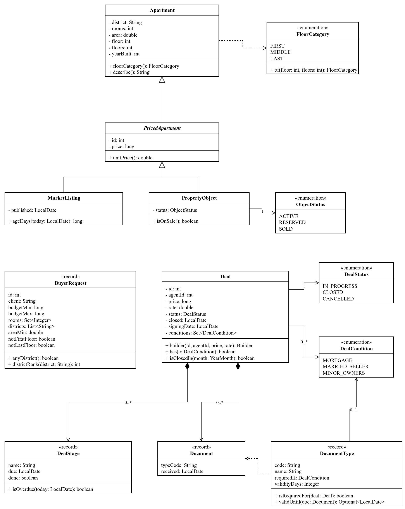
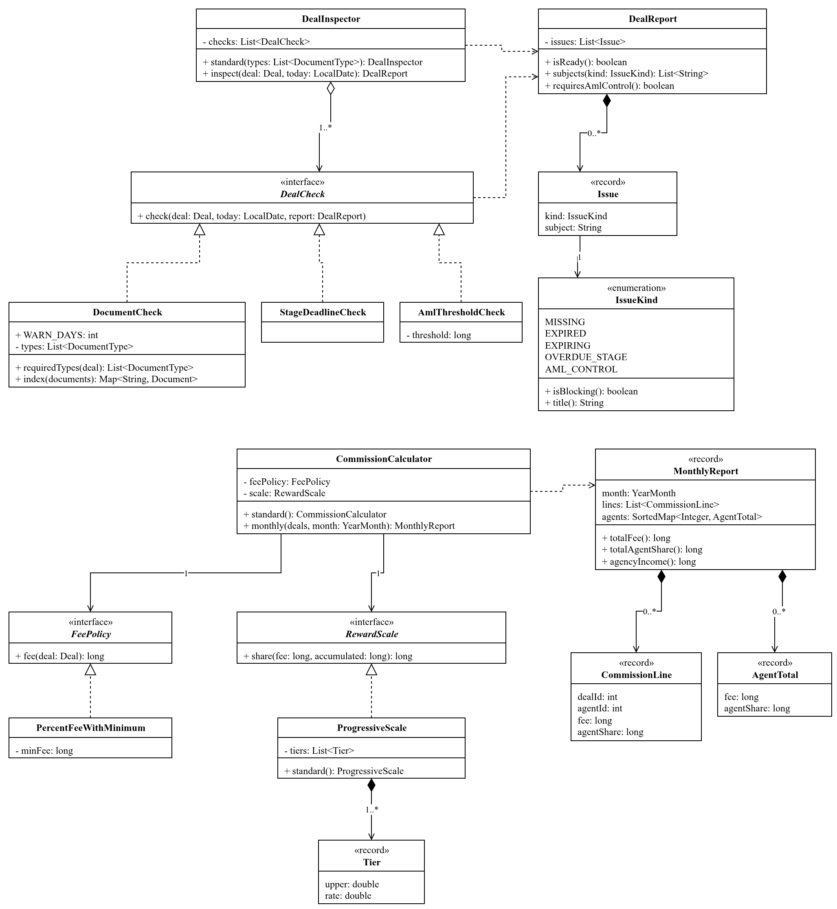

# 1. Проектирование классов, иерархий наследования и интерфейсов

> Черновик. Диаграммы: `diagrams/uml-klassy.drawio` (4 страницы), генерируются `tools/diagrams/gen.py uml`, PNG — `tools/diagrams/export.sh`. Код: `src/java/`.

## 1.1. Принципы проектирования

Объектно-ориентированная реализация решает те же задачи, что и процедурная: оценку стоимости квартиры, подбор объектов под заявку покупателя, контроль документов и сроков сделки и расчёт комиссии. При проектировании приняты следующие решения:

- классы предметной области построены по сущностям логической модели данных, конструкторы проверяют допустимость значений;
- изменяемые правила алгоритмов вынесены в интерфейсы, и новое правило добавляется новым классом без изменения класса алгоритма;
- объекты неизменяемы, простые структуры данных объявлены как записи (`record`);
- результат алгоритма представлен типизированным объектом, а не словарём.

Классы распределены по пакетам в соответствии с модулями процедурной реализации (Таблица 1.1). Всего спроектировано 54 типа: 8 интерфейсов, 6 перечислений, 13 записей и 27 классов.

| Пакет | Назначение | Основные типы |
|---|---|---|
| `realty.model` | предметная область | `Apartment`, `PricedApartment`, `MarketListing`, `PropertyObject`, `BuyerRequest`, `Deal`, `DealStage`, `Document`, `DocumentType` |
| `realty.valuation` | алгоритм 1: оценка стоимости | `Valuator`, `ComparativeValuator`, `PriceAdjustment`, `ValuationResult` |
| `realty.matching` | алгоритм 2: подбор объектов | `ObjectMatcher`, `RequestFilter`, `ScoreComponent`, `WeightedScore` |
| `realty.documents` | алгоритм 3: контроль сделки | `DealInspector`, `DealCheck`, `DealReport`, `Issue` |
| `realty.commission` | алгоритм 4: расчёт комиссии | `CommissionCalculator`, `FeePolicy`, `RewardScale` |
| `realty.io` | загрузка исходных данных | `Json`, `DataLoader`, `DataSet` |

## 1.2. Иерархия классов предметной области

Классы предметной области показаны на Рисунке 1.1. Корневой класс `Apartment` описывает характеристики, по которым квартиры сравниваются: район, число комнат, площадь, этаж, этажность и год постройки. Абстрактный класс `PricedApartment` добавляет цену и расчёт цены 1 м². От него наследуются `MarketListing` (рыночное предложение) и `PropertyObject` (объект агентства со статусом). Метод оценки принимает `Apartment`, поэтому оценить можно и объект агентства.

Заявка, этап сделки, документ и тип документа объявлены записями и содержат относящиеся к ним правила, например `DealStage.isOverdue`. Статусы и условия представлены перечислениями, поэтому опечатка в статусе обнаруживается при компиляции. Сделка (`Deal`) создаётся построителем, а этапы и документы входят в её состав. Сущности, не участвующие в алгоритмах (клиент, сотрудник, договор, показ), будут реализованы в физической модели данных.

## 1.3. Интерфейсы алгоритмов

Каждый алгоритм реализован классом, который получает изменяемые правила через интерфейсы (Таблица 1.2).

| Интерфейс | Назначение | Реализации |
|---|---|---|
| `PriceAdjustment` | корректировка цены аналога | `BargainDiscount`, `FloorAdjustment` |
| `ValuationResult` (запечатанный) | результат оценки | `Estimate`, `Insufficient` |
| `RequestFilter` | условие заявки | перечисление `StandardFilter` (6 условий) |
| `ScoreComponent` | составляющая оценки соответствия | `PriceScore`, `AreaScore`, `DistrictScore` через `WeightedScore` |
| `DealCheck` | проверка сделки | `DocumentCheck`, `StageDeadlineCheck`, `AmlThresholdCheck` |
| `FeePolicy`, `RewardScale` | комиссия агентства и вознаграждение агента | `PercentFeeWithMinimum`, `ProgressiveScale` |

В алгоритме оценки (Рисунок 1.2) удельная цена аналога последовательно проходит через список корректировок. Результат описан запечатанным интерфейсом с двумя подтипами, и компилятор проверяет, что при разборе рассмотрены оба случая.

В алгоритме подбора (Рисунок 1.3) класс `ObjectMatcher` агрегирует условия заявки и составляющие оценки. Абстрактный класс `WeightedScore` хранит вес, а подклассы рассчитывают соответствие по цене, площади и району.

В алгоритмах 3 и 4 (Рисунок 1.4) класс `DealInspector` применяет к сделке список проверок, а `CommissionCalculator` получает правило комиссии и шкалу вознаграждения. Шкала проверяет корректность ступеней при создании.

В проекте использованы инкапсуляция, наследование (`Apartment` → `PricedApartment` → `MarketListing`, `PropertyObject`), полиморфизм и абстракция, а также шаблоны «Стратегия» и «Строитель». Структура соответствует принципу открытости/закрытости: новое правило добавляется новым классом, классы алгоритмов не меняются.
