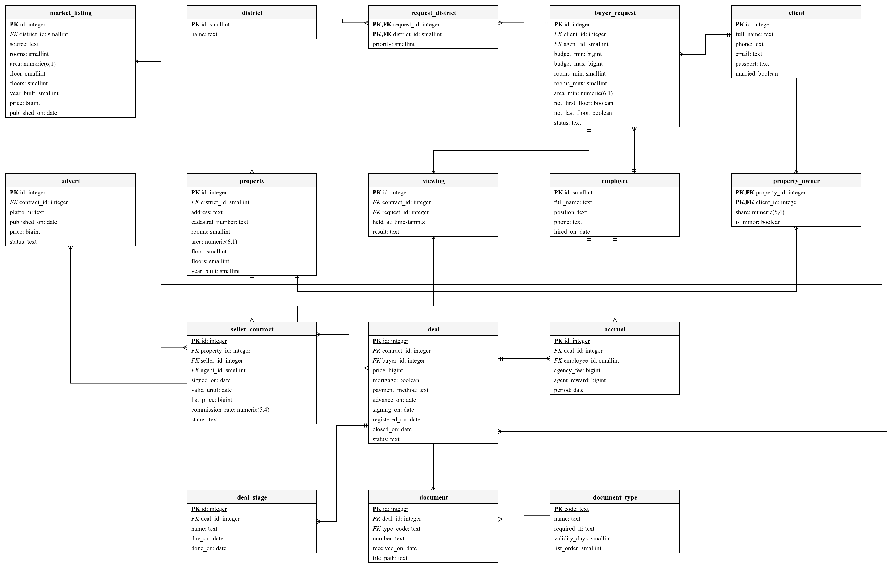

# 1. Физическая модель данных

> Черновик. Схема: `src/sql/schema.sql`, данные: `src/sql/seed.sql` (формируется `gen_seed.py` из `src/python/data/sample.json`), выгрузка: `src/sql/export.sql`, тесты: `src/sql/tests.sql`. Диаграмма: `diagrams/er-fizicheskaya-model.drawio`, генерируется `tools/diagrams/gen.py physical` по `schema.sql`.

## 1.1. Состав модели

Физическая модель построена по логической модели аналитического этапа средствами системы управления базами данных (СУБД) PostgreSQL. Скрипт создания проверен на версии 18.6 и не использует возможностей новее версии 16. Каждой из 16 сущностей соответствует таблица в схеме `realty` (Рисунок 1.1). Имена таблиц и столбцов записаны латиницей, а их назначение описано комментариями `COMMENT ON` на русском языке.

{landscape}

Типы данных выбраны по правилам, приведённым в Таблице 1.1.

| Вид атрибута | Тип PostgreSQL | Обоснование |
|---|---|---|
| Суррогатный ключ | `integer GENERATED ALWAYS AS IDENTITY`, для справочников `smallint` | значение ключа назначает СУБД |
| Цены, комиссии | `bigint` | суммы в целых рублях без ошибок округления |
| Площадь, доля, ставка | `numeric(6, 1)`, `numeric(5, 4)` | точная десятичная запись |
| Этаж, число комнат, год | `smallint` | малый диапазон значений |
| Даты событий | `date`, время показа — `timestamptz` | календарные операции СУБД |
| Статусы и условия | `text` с ограничением `CHECK (... IN (...))` | новый статус добавляется без изменения типа |

## 1.2. Ограничения целостности и индексы

Правила предметной области, которые на предыдущих этапах проверял только код, перенесены в СУБД:

- этаж не выше этажности дома, площадь и цена положительны;
- нижняя граница бюджета заявки не больше верхней, минимальное число комнат не больше максимального;
- у квартиры не больше одного действующего договора с продавцом (частичный уникальный индекс);
- закрытая сделка всегда имеет дату закрытия, а дата регистрации не раньше даты подписания;
- вознаграждение агента не больше комиссии агентства, период начисления начинается с первого числа месяца;
- телефон, адрес электронной почты, паспорт и кадастровый номер проверяются регулярными выражениями.

PostgreSQL не создаёт индексы по внешним ключам автоматически, поэтому они добавлены явно для всех внешних ключей. Ещё два индекса ускоряют алгоритмы: составной индекс по району, числу комнат и дате публикации для отбора аналогов и частичный индекс по дате закрытия сделок для расчёта комиссии. Всего в схеме 20 дополнительных индексов, а тест проверяет, что у каждого внешнего ключа есть индекс.

## 1.3. Уточнения логической модели и проверка

При построении физической модели выявлено, что в логической модели нет атрибута для условия «продавец состоит в браке», от которого зависит обязательность согласия супруга. В таблицу клиентов добавлен столбец `married`. В справочник типов документов добавлен порядок вывода в перечне проверки. Условия сделки для алгоритма 3 вычисляются представлением `deal_conditions`, а цена и статус квартиры по действующему договору — представлением `property_on_sale`.

Условные данные аналитического этапа загружаются в БД скриптом `seed.sql`, а запрос `export.sql` выгружает их обратно в формате JSON. Процедурная и объектно-ориентированная реализации, запущенные на выгрузке из БД, выдают результат, совпадающий с результатом на исходном файле.
